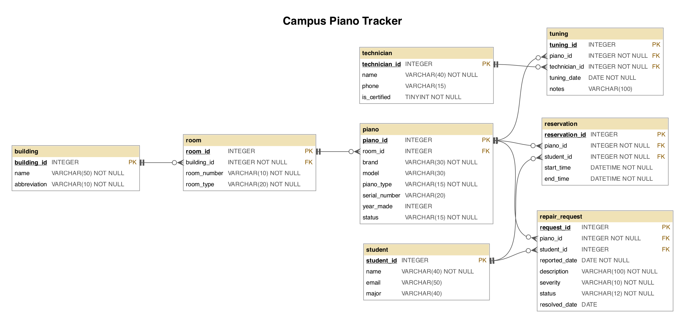

# Campus Piano Tracker

My project models the pianos on a university campus: which building and room each piano is in, when it was tuned and by which technician, repair requests students file, and student practice reservations. A music department could use it to decide which pianos need a technician and which ones students can actually use.



**How it works:** you type a question into a small web page (Flask). The app sends the question and the `CREATE TABLE` schema to `gpt-4o-mini` to get a SQLite query. It runs that query on a **read-only** connection (it must be a single `SELECT`; if the query fails, the model gets one retry with the error message). Then it sends the question, SQL and rows back to the model for a plain-English answer. `run_eval.py` runs 11 questions through all three prompting strategies from the paper and saves the results to `results/`.

## Query I thought it did well on

**Question**: Which pianos haven't been tuned in the last 6 months?

**GPT SQL Response** (zero-shot):
```sql
SELECT p.brand, p.model, p.piano_type, p.serial_number, p.year_made, p.status
FROM piano p
LEFT JOIN tuning t ON p.piano_id = t.piano_id AND t.tuning_date >= date('2026-10-12', '-6 months')
WHERE t.tuning_id IS NULL;
```

**Friendly Response**: The following pianos haven't been tuned in the last 6 months: Yamaha U1, Baldwin Hamilton, Yamaha P-125, Young Chang G-157, Yamaha U3, Baldwin Acrosonic, Steinway & Sons Model M, Roland FP-30X.

This is correct (all 8). I was impressed that it put the date filter **inside the `ON` clause** of the `LEFT JOIN`. That way pianos that were *never* tuned are included too, which is an easy thing for a person to get wrong. (Single-domain prompting got this exact question wrong; see below.)

## Question that it tripped up on

**Question**: Who tuned the Steinway in the concert hall most recently?

**GPT SQL Response** (all three strategies wrote essentially the same thing):
```sql
SELECT t.name AS technician_name, tu.tuning_date
FROM tuning tu
JOIN piano p ON tu.piano_id = p.piano_id
JOIN room r ON p.room_id = r.room_id
JOIN technician t ON tu.technician_id = t.technician_id
WHERE p.brand = 'Steinway' AND r.room_type = 'concert hall'
ORDER BY tu.tuning_date DESC
LIMIT 1;
```

SQL Result: `[]`

**Friendly Response**: No matching records were found.

The joins and ordering are perfect, but the brand is stored as `'Steinway & Sons'`, not `'Steinway'`. The model only sees the schema, never the data, so it guessed the value. The real answer is **Marcus Webb on 2026-08-20**. The worse part is that "No matching records were found" sounds like a confident answer. A user would believe nobody has tuned that piano. Using `LIKE '%Steinway%'`, or putting a few sample rows in the prompt (the paper calls this including *table content*), would probably fix it.

## Prompting strategies

I tried all three strategies from [Chang & Fosler-Lussier, *How to Prompt LLMs for Text-to-SQL* (arXiv:2305.11853)](https://arxiv.org/abs/2305.11853), each on the same 11 questions with `gpt-4o-mini`, temperature 0:

- **zero_shot**: just the schema and the question.
- **single_domain**: the schema plus 2 example question/SQL pairs from *my* piano database.
- **cross_domain**: 1 example question/SQL pair from a *different* database (the dog show schema from the class example), then my schema and the question.

I checked every answer by hand against the data:

| Strategy | Correct | Partly right | Wrong | Cost (11 questions) |
|---|---|---|---|---|
| zero_shot | 8 | 1 | 2 | $0.0023 |
| single_domain | 6 | 1 | 4 | $0.0023 |
| cross_domain | **9** | 1 | 1 | $0.0029 |

I expected single-domain to win, but it did the **worst**, because the model copied my examples too literally:

- One example filtered on `b.abbreviation = 'HFAC'`. For *"Can I reserve a piano in the Brimhall Building?"* it copied that pattern and guessed `b.abbreviation = 'BB'`, but the real abbreviation is `'BRMB'`. It returned no rows and answered "No matching records were found," which sounds like "no."
- The other example used the `LEFT JOIN ... WHERE t.tuning_id IS NULL` pattern. For *"haven't been tuned in the last 6 months"* it put the date check in the `WHERE` instead of the `ON`. Any piano with an old tuning then matched, so it listed 11 pianos instead of 8, including the concert-hall Steinway that was tuned in August.
- For *"Which pianos need repair?"* it used `repair_request` instead of `piano.status`, which gave duplicate rows. The friendly answer then garbled them and called the Young Chang's model number "room G-157."

Cross-domain was the most accurate. It was also the only strategy that understood "Can I reserve…" meant "is there an active, unreserved piano" (it found Kawai in room 120). Zero-shot wrote an impossible date filter (`start_time > '2026-10-12' AND end_time < '2026-10-12'`) for the same question. My takeaway is that examples change the model's *style* more than its *understanding*. Bad or narrow in-domain examples can hurt more than they help.

One question tricked all three strategies in a quiet way. *"Which piano has the most open repair requests?"* is actually a 3-way tie (1 open request each). Every strategy used `LIMIT 1` and confidently named just the Young Chang.

## My own question: right answer, wrong SQL

**Question**: Which piano has gone the longest without being tuned?

**GPT SQL Response** (zero-shot; cross-domain wrote the same thing):
```sql
SELECT p.brand, p.model, p.serial_number, MIN(t.tuning_date) AS last_tuning_date
FROM piano p
LEFT JOIN tuning t ON p.piano_id = t.piano_id
GROUP BY p.piano_id
ORDER BY last_tuning_date ASC
LIMIT 1;
```

SQL Result: `[('Yamaha', 'P-125', 'YM-D77120', None)]`

**Friendly Response**: The piano that has gone the longest without being tuned is a Yamaha P-125 with the serial number YM-D77120, and it has never been tuned.

All three strategies gave this answer, and it *sounds* right, but zero-shot and cross-domain got there by luck:

- They named the column `last_tuning_date` but computed `MIN(tuning_date)`, which is the piano's **first** tuning. The "last" tuning needs `MAX`. Only single-domain wrote `MAX`.
- The query still landed on the right kind of answer because SQLite sorts `NULL` first in `ORDER BY ... ASC`, so never-tuned pianos come out on top no matter what. Without the never-tuned pianos, the `MIN` version would rank pianos by when they were *first* tuned, which is wrong.
- `LIMIT 1` hides a 3-way tie: the Yamaha P-125, the Roland FP-30X and the stored Steinway Model M have all never been tuned.
- The model doesn't know that the P-125 is a **digital** piano, which never needs tuning. The most useful real answer is probably "the Baldwin Acrosonic, last tuned 2023-09-09," or the stored Steinway.

This was the scariest result: a confident, correct-sounding answer built on SQL with a logic bug. You'd only catch it by reading the query.

## Cost

All 33 runs (11 questions × 3 strategies, two GPT calls each) cost **$0.0075** total, about **$0.0002 per question**, with `gpt-4o-mini` at $0.15 / $0.60 per million input/output tokens. Each prompt was roughly 800–1,200 input tokens, mostly the schema. Cost is basically a non-issue at this scale.

## Conclusion

`gpt-4o-mini` is very good at the *structure* of SQL: multi-table joins, `GROUP BY`/`HAVING`, and even the tricky `LEFT JOIN ... ON` date filter. It was never stopped by a syntax error. Its failures were all about **data it couldn't see** (`'Steinway'` vs `'Steinway & Sons'`, `'BB'` vs `'BRMB'`) and **vague questions** ("Can I reserve…" when?). The dangerous part is the friendly answer layer: an empty result turns into a confident "No matching records were found," and a person can't tell that apart from a true "no." As a tool for engineers who can read the SQL, it's great. For non-technical users, I'd want it to show the SQL, include sample values in the prompt, and say "I couldn't find X" instead of a flat "no."

**Going further:** to make this work for *any* database, I think you'd need to automatically pull in the schema **plus** distinct values for short text columns (brands, statuses, abbreviations), retry when a query comes back empty, and ask a clarifying question when a request is ambiguous.

More examples: [examples.md](examples.md) · Raw results: [`results/`](results/)
